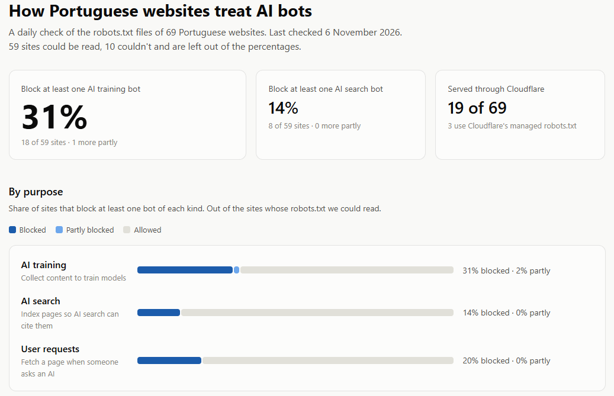
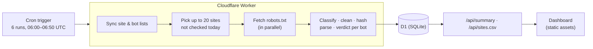

# PT AI Blockers

**How Portuguese websites treat AI crawlers, measured every day on Cloudflare Workers.**

[**Live dashboard**](https://pt-ai-blockers.ricardofixe.workers.dev/) · [Data (CSV)](https://pt-ai-blockers.ricardofixe.workers.dev/api/sites.csv) · [Data (JSON)](https://pt-ai-blockers.ricardofixe.workers.dev/api/summary)



---

## Why

AI companies now more than ever crawl news sites, universities and public portals every day, to train models, to power AI search, and to fetch pages live when someone asks a chatbot a question. For most sites the only way to say "no" is `robots.txt`, a convention from 1994 that became a standard in 2022 ([RFC 9309](https://www.rfc-editor.org/rfc/rfc9309)).

It's a problem every company has learned to live with, and nobody is measuring it. Which Portuguese sites block AI training? Do they block AI search too, and lose the traffic it sends? Are their rules even correct, or do they name bots that aren't even running anymore?

**PT AI Blockers** checks the `robots.txt` of 69 major Portuguese websites every morning, reads it the way a crawler would, and publishes what each site asks of 17 AI bots.

## What the checker found

_6 November 2026, from the live Worker. 59 of 69 sites could be read, the other 10 answered with bot checks (8) or server errors (2) and are left out of the percentages._

- **31% fully block at least one AI training bot** (18 of 59), and 1 more blocks one partly.
- **It's a media decision.** More than half of the readable broadcasters (5 of 9) and sports sites (5 of 9), and 6 of 14 news sites, block AI training. Public institutions: **0 of 7**. Universities: **1 of 10**. Four public institutions (gov.pt, Portal das Finanças, INE and the Parliament) have no `robots.txt` at all, and SNS answers with an error (405). Under the standard, both count as allowing every crawler.
- **Block training, keep search.** 10 sites block AI training but leave AI search bots allowed, while no site does the opposite. 8 block OpenAI's training crawler (GPTBot) while allowing its search crawler (OAI-SearchBot), so they are out of the training data, but still citable in ChatGPT's answers.
- **OpenAI is blocked twice as often as Anthropic.** GPTBot is blocked by 16 sites (and partly by 2 more), ClaudeBot by 8. ChatGPT-User is the most-blocked bot that acts on a user's request (12 sites), and 7 of those sites block no other bot of that kind, even though OpenAI says robots.txt may not apply to it.
- **Copied blocklists.** 8 sites still list Anthropic's retired bot names (`anthropic-ai`, `Claude-Web`). All of them also block the current ClaudeBot, so the old entries are leftovers from shared lists rather than gaps.
- **Cloudflare.** 19 of 69 sites are served through Cloudflare. Among readable ones, 8 of 15 (53%) block AI training, against 10 of 44 (23%) elsewhere. 3 use Cloudflare's managed robots.txt, and all 3 declare the same Content Signal: `search=yes, ai-train=no, use=reference`.
- **A block that did nothing.** Observador used Cloudflare's managed robots.txt until 5 November, when the managed section disappeared from its file. That section disallowed AI training bots, but Observador's own rules gave the same bots `Allow: /`. Under RFC 9309 a bot's groups are merged and `Allow` wins a tie, so the block never applied, and removing it changed none of Observador's verdicts.

The sample is small, so read the percentages as indicative. The checker runs daily, so the dashboard also builds a history of when sites change their policies.

## How it works



1. **Schedule.** A cron trigger runs the Worker six times each morning. Each run checks up to 20 sites that haven't been checked that day, so four runs cover all 69 and two are spare.
2. **Fetch.** Each site's `https://<host>/robots.txt` is fetched with an honest User-Agent, a 10-second timeout and redirects followed. The response is classified between a real robots.txt, no file (404), a server error, unreachable, or something that isn't a robots.txt (usually a bot check).
3. **Parse.** The file is cleaned (line endings, whitespace, byte-order mark), hashed with SHA-256 and parsed into groups. For each of the 17 bots, the checker decides: **blocked**, **partly blocked** or **allowed**.
4. **Store.** Results go into D1 in one transaction. Each unique file is stored once, and each site's history is a list of periods during which nothing changed.
5. **Serve.** The Worker answers `/api/summary` and `/api/sites.csv` and the dashboard is a static page served by Cloudflare that renders the JSON.

## Engineering decisions

**Fitting the free plan.** A Worker run on the free plan gets 50 subrequests, 10 ms of CPU and 6 concurrent connections, and checking 69 sites in one run doesn't fit. So each run does exactly 4 database calls plus at most 40 fetches (44 subrequests, one robots.txt request and one DNS lookup per site), and writes everything in a single `db.batch()`, which counts as one query and is one transaction. The batches are **self-healing**: "not checked today" is derived from the data itself, so if a run fails, the next one picks up whatever is left.

**Storing changes, not snapshots.** Saving every file every day would store the same thing thousands of times. Instead, each file is content-addressed by its SHA-256 hash and stored once, its verdicts are computed once, and each site's history is a set of **periods** (`first_seen`, `last_seen`) that only split when something changes. A period is only extended if the site was also seen the day before, so days the checker missed show up as gaps instead of being silently covered. Because the raw files are kept, every verdict can be recomputed after a parser fix without refetching anything.

**A parser that follows RFC 9309.** The parser handles the parts real files get wrong, like a bot's own group overriding `*` entirely, merging repeated groups for the same bot, case-insensitive names, version suffixes (`GPTBot/1.1`), comments anywhere, empty values, and Windows line endings. Ambiguous cases the RFC doesn't settle are documented decisions: an empty `User-agent:` starts a group that matches no bot (so one typo can't turn into "blocks everyone"), and `Crawl-delay` ends a list of user agents.

**"Unknown" is not "no".** A bot-check page, an error or a timeout says nothing about a site's AI policy, so those sites are counted separately and left out of every percentage, rather than quietly counted as "allows everything". Dropping them from the sample would bias it, since sites with aggressive bot protection are likely also the ones blocking AI. The same rule runs through the data, where `NULL` means "couldn't check" and is never stored as `0`. A response only counts as a robots.txt if it looks like one, so a JSON error or an HTML page served with a 200 can't be misread as an empty file.

**Letting the database enforce the rules.** `CHECK` constraints keep every verdict, outcome and purpose to its allowed values, and require that a period has a file exactly when the outcome is `ok`. Foreign keys make history impossible to orphan, which is also why bots and sites are never deleted, only marked. Schema changes go through D1 migrations.

**Untrusted input stays untrusted.** robots.txt files and Content-Signal values are written by other people. Every SQL value goes through bound parameters, and the dashboard inserts all data with `textContent`, never `innerHTML`.

## Methodology and limitations

- **It measures what sites ask, not what bots do.** robots.txt is a request. Some bots that act on a user's behalf say it may not apply to them, and some crawlers ignore it.
- **Bot purposes come from each operator's documentation** ([`src/bots.ts`](src/bots.ts) links every source). Google-Extended and Applebot-Extended aren't crawlers, they're tokens that opt content out of AI training while normal crawling continues. Bots with no public documentation (Bytespider) are classified from secondary sources and marked as such.
- **Blocked / partly blocked / allowed.** _Blocked_: the bot may not access `/` and nothing is allowed back. _Partly_: the root is blocked with some paths allowed back, or the bot's own rules block specific sections. Generic rules for every bot (like `/admin/`) don't count. A site "blocks a purpose" if it blocks at least one current bot of that kind.
- **Cloudflare detection** checks whether the site's IP addresses are in Cloudflare's published ranges, which means it's served through Cloudflare's proxy. An earlier version used the `cf-ray` response header, which works from a normal computer but not from a Worker, because the Worker's own requests pass through Cloudflare. Sites using Cloudflare only for DNS count as not on Cloudflare, and network-level bot blocking isn't visible in robots.txt.
- **Some sites refuse the Worker.** Requests from a Worker come from Cloudflare's network, and some sites turn those away. 6 sites that could be read from a home connection on 4 November (among them Público and two universities) answer the Worker with a bot check or an error, so fewer sites are readable in production than in a local run.
- **The sample** is 69 sites chosen for reach and coverage of sectors: national news media, TV and radio, sports media, clubs and governing bodies, tech and lifestyle sites, universities and public institutions. Groups are small (10–15 sites), so one site can move a sector's number noticeably.

## Project structure

| Path                                                         | What it does                                                                                                     |
| ------------------------------------------------------------ | ---------------------------------------------------------------------------------------------------------------- |
| [`src/parser.ts`](src/parser.ts)                             | `parseRobots` (text → groups), `verdictFor` (groups + bot → verdict), managed-block and Content-Signal detection |
| [`src/checker.ts`](src/checker.ts)                           | Fetching one site, classifying the response, cleaning and hashing                                                |
| [`src/store.ts`](src/store.ts)                               | Reading the latest periods and saving a batch of results in one transaction                                      |
| [`src/run.ts`](src/run.ts)                                   | One scheduled run with sync, pick unchecked sites, check, save                                                   |
| [`src/report.ts`](src/report.ts)                             | Turning the database into the dashboard data and the CSV                                                         |
| [`src/index.ts`](src/index.ts)                               | The Worker: API routes and the cron handler                                                                      |
| [`src/sites.ts`](src/sites.ts), [`src/bots.ts`](src/bots.ts) | The tracked sites and bots synced into D1                                                                        |
| [`migrations/`](migrations/)                                 | The database schema                                                                                              |
| [`public/index.html`](public/index.html)                     | The dashboard                                                                                                    |
| [`test/`](test/)                                             | Unit tests                                                                                                       |

## Running it

Requires Node.js and a Cloudflare account (the free plan is enough).

```sh
npm install
npx wrangler d1 create pt-ai-blockers            # put the printed database_id in wrangler.jsonc
npx wrangler d1 migrations apply pt-ai-blockers --local
npm test                                          # 69 tests
npx wrangler dev --test-scheduled                 # then open /__scheduled to run a batch
```

Open `/__scheduled` once per batch (four times for all sites), then open the root URL for the dashboard. To deploy: `npx wrangler d1 migrations apply pt-ai-blockers --remote`, then `npm run deploy`.

## Tests

69 unit tests, written mostly before the code they cover:

- **Parser:** every grouping rule above, plus messy input (comments inside paths, `\r\n`, garbage lines, colons in paths, wildcards kept verbatim).
- **Verdicts:** named group vs `*`, merged groups, version suffixes, exact-name matching (`Applebot` ≠ `Applebot-Extended`), the RFC's tie rule (`Allow: /` cancels `Disallow: /`).
- **Checker:** response classification for HTML, JSON, XML, plain-text and Markdown bodies served with a 200, refused vs missing vs broken servers, normalization before hashing, and a known SHA-256 vector.
- **Storage:** when a period extends or splits, gaps, and `NULL` vs `0`.
- **Report:** the denominators, "at least one bot", retired names, the Cloudflare comparison and CSV escaping.

## What I'd build next

- **History from the Internet Archive.** Backfill archived robots.txt files to show how blocking changed since 2023, when GPTBot appeared.
- **A fix-it checker.** Enter a domain, get a plain-language report and a corrected robots.txt for the policy you actually want (for example "no training, yes search").
- **A larger sample** from the most-visited `.pt` domains, and a comparison with Cloudflare Radar's global numbers.
- **Streaming the 500 KiB cap**, so huge files are cut while downloading rather than after.

---

Built by Ricardo Isidro in Lisbon. I used an AI assistant as a pair programmer to discuss design options and draft code, the design decisions are mine, and I reviewed every line.
